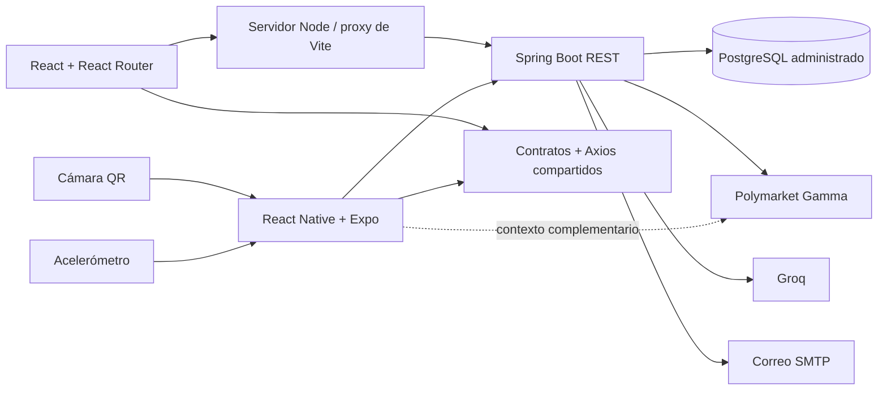

# Arquitectura de la fase 2

## Capas
Los componentes presentacionales viven en `components`, las pantallas en `pages` o `screens`, la carga y cancelación en `hooks`, los estados globales en `contexts` y el acceso HTTP en `services` y `packages/api`. Las interfaces compartidas reflejan los DTO del backend en español; los nombres de funciones, variables y componentes están en inglés.

La web usa rutas dinámicas y query params. Las vistas se cargan con React.lazy y Suspense. El componente Protected controla autenticación y rol; la autorización definitiva se aplica también en el backend. ErrorBoundary captura fallos de renderizado.

Móvil usa React Navigation con un native stack y bottom tabs. Las consultas se cancelan cuando la pantalla pierde foco. La cámara y el acelerómetro dejan de estar activos fuera de su pantalla o al pasar la app a segundo plano.

## Sesión
- Access token JWT: 15 minutos por defecto, configurable con JWT_EXPIRATION.
- Web: access token solo en memoria. Refresh token opaco en cookie HttpOnly, SameSite=Lax y Secure en producción.
- Móvil: sesión en Expo SecureStore con acceso WHEN_UNLOCKED_THIS_DEVICE_ONLY.
- El servidor persiste solo el hash SHA-256 del refresh token, con expiración de 30 días.
- Cada refresh revoca el anterior y crea otro. Un bloqueo de fila impide la rotación concurrente del mismo token.
- El interceptor comparte una única renovación entre solicitudes concurrentes y reintenta una vez la solicitud autenticada.
- Cerrar sesión revoca el refresh token. El JWT de acceso puede conservar validez hasta su vencimiento.
- Los endpoints de refresh/logout requieren el header no simple X-Client-Type. Los orígenes CORS deben mantenerse restringidos.
- La web usa el proxy del mismo origen para evitar depender de cookies de terceros.
- El cliente no repite automáticamente POST, PUT ni DELETE. Solo reintenta GET ante fallos de red o 502/503/504.
- Cambiar contraseña no revoca por sí solo todas las sesiones existentes; se puede ampliar con un registro de sesiones por usuario.

## Datos y representación
Las dos paginaciones principales usan `/mercados` y `/ediciones`, con totalElements, totalPages, number, size y content. Los filtros y ordenamiento se ejecutan en el backend. El gráfico se construye a partir de snapshots reales del backend y ofrece una tabla accesible en web.

La API externa en móvil añade la descripción y el volumen del mercado original de Polymarket. Es complementaria: portada, historial, guardados y temas dependen de nuestro backend. Si falla, el diario mantiene su funcionalidad principal.

## Backend extendido
Se añadieron refresh sessions, respuestas 401/403 explícitas, contexto de transacción para relaciones LAZY, manejo de conflictos de integridad, endpoint de estado con comprobación de DB, configuración por entorno, administrador por variables y perfiles de demostración/pruebas. Las fechas de portada y el cron diario usan America/Lima.

La base H2 de demostración sirve para revisar flujos sin credenciales. Producción utiliza PostgreSQL; H2 no reemplaza la prueba final contra esa infraestructura.
