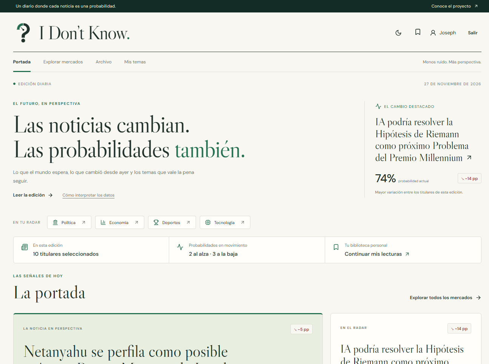
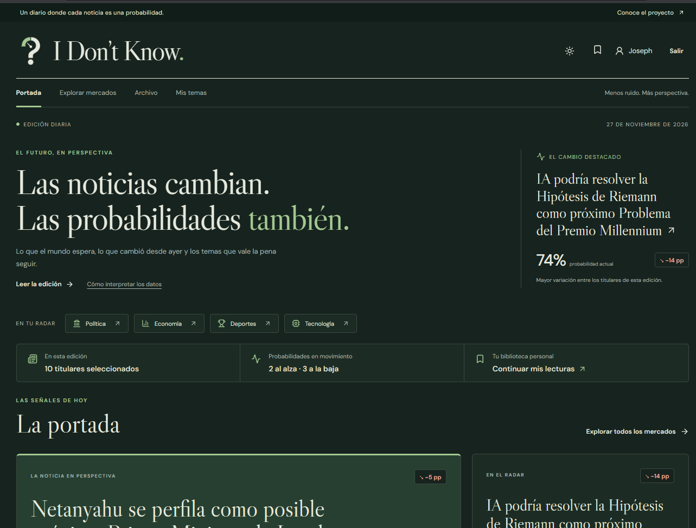
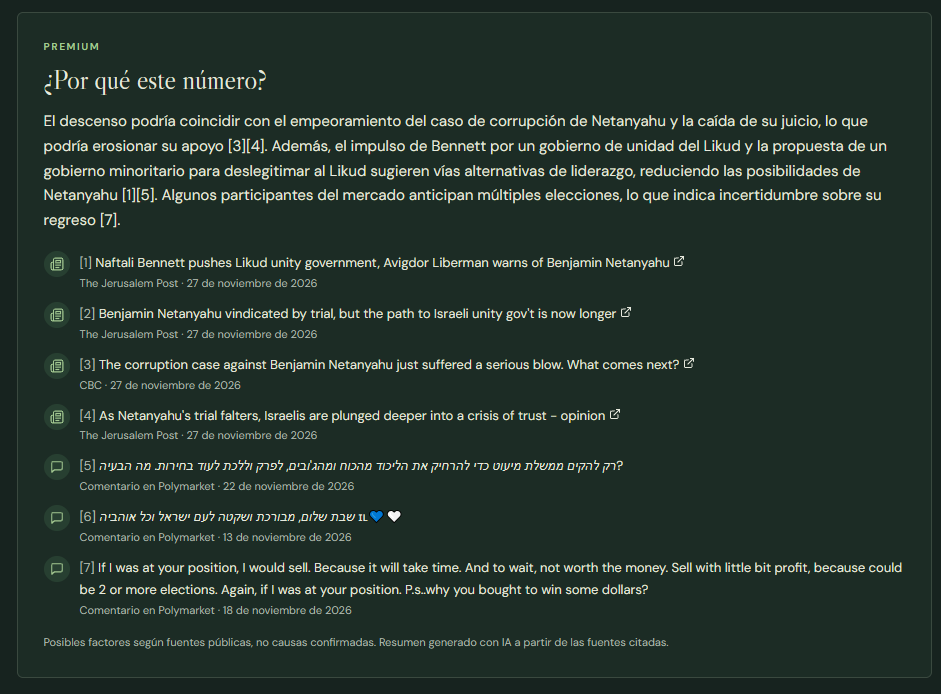

# Evidencias de entrega

Registro actualizado el 27 de noviembre de 2026, antes de la final del Premio Tim Berners-Lee. Los resultados corresponden a las comprobaciones descritas y pueden cambiar con nuevas sincronizaciones. El registro anterior, del 10 de noviembre, queda al final como historial.

## Accesos

- [Web pública](https://18-223-255-39.sslip.io/)
- [Estado de la API](https://18-223-255-39.sslip.io/api/v1/estado)
- [APK Android](https://expo.dev/accounts/tuskanips-team/projects/idontknow-dbp/builds/e3960d2d-073c-46ef-9afc-7271f8f8172a)

EC2 ejecuta web y backend mediante Docker Compose. Caddy publica HTTPS y RDS guarda los datos en PostgreSQL privado. Expo distribuye el APK.

## Capturas del 27 de noviembre

| Web en modo claro | Web en modo oscuro |
| --- | --- |
|  |  |

| “¿Por qué este número?” con una cuenta Premium | App en un Android físico |
| --- | --- |
|  |  |

## Comprobaciones de producción (27 de noviembre)

- Estado de la API: HTTP 200 con `status=ok` y `demo=false`.
- Portada del 27 de noviembre con 10 titulares.
- Explicaciones generadas automáticamente con fuentes reales. En el titular de Netanyahu, con una cuenta Premium, el resumen cita 7 fuentes: 4 noticias (The Jerusalem Post y CBC) y 3 comentarios del evento en Polymarket. Sin Premium, la misma ruta devuelve solo el adelanto con `bloqueado: true`, la cantidad y el tipo de fuentes.
- Tema claro y oscuro en la web: el botón de sol/luna cambia los colores y el logo de la cabecera.
- Android físico: el APK del build `e3960d2d` se instaló y cargó la portada desde producción, con el modo oscuro del sistema.

## Latencia con datos reales

Tres solicitudes consecutivas por endpoint, medidas el 27 de noviembre desde el equipo de desarrollo contra HTTPS con `scripts/check-endpoints.mjs`. Incluyen el tiempo de red desde ese equipo. La primera solicitud a `/estado` incluye el establecimiento de la conexión.

| Endpoint bajo `/api/v1` | HTTP | Muestras (ms) | Media (ms) |
| --- | --- | --- | --- |
| `/estado` | 200 | 569, 325, 109 | 334 |
| `/categorias` | 200 | 117, 116, 118 | 117 |
| `/mercados?page=0&size=10` | 200 | 231, 140, 130 | 167 |
| `/ediciones?page=0&size=10` | 200 | 166, 149, 186 | 167 |
| `/ediciones/hoy` | 200 | 119, 121, 116 | 119 |

Las cinco medias están por debajo del objetivo de 500 ms.

## Pruebas y validaciones

- Commit `90b7c22` (27 de noviembre): TypeScript de los tres workspaces, 5 pruebas del cliente compartido y 9 de la web aprobadas, build de producción de la web y exportación del bundle Android sin errores.
- Backend: 61 pruebas aprobadas en la ejecución registrada el 25 de noviembre (ver [despliegue](DEPLOYMENT.md#explicaciones-con-fuentes)). Después se agregaron las pruebas del filtro de portada (`FiltroTemasTest`). GitHub Actions ejecuta la suite completa del backend y del frontend en cada push a `master`.
- Las pruebas del backend cubren, entre otros, la extracción de palabras clave, los clientes de GDELT, RSS y comentarios de Polymarket con servidores HTTP locales, el bloqueo de entidades XML externas y el flujo Premium completo (adelanto sin sesión, suscripción, explicación completa, cancelación, 404 y 403).

## Pendientes del equipo

- Correo: el envío de bienvenida y alertas está implementado, pero sigue desactivado en producción hasta configurar y validar SMTP.
- La suscripción Premium es una simulación de 30 días sin cobro; no hay pasarela de pagos.

## Historial: registro del 10 de noviembre de 2026

- Registro: HTTP 201; login y renovación: HTTP 200; cierre de sesión: HTTP 204, con cookie Secure y HttpOnly.
- Traducción: HTTP 200 en `/mercados/1/traduccion`, con texto original y versión en español.
- Mercados por categoría tras la sincronización puntual: política 119, economía 50, deportes 50 y tecnología 47. Las categorías pueden superponerse.
- Latencias medias de ese día: `/estado` 297 ms, `/categorias` 130 ms, `/mercados` 161 ms, `/ediciones` 153 ms y `/ediciones/hoy` 132 ms.
- Búsqueda básica de credenciales en archivos y revisiones Git sin coincidencias de los patrones inspeccionados. Sin archivos `.env` o `.pem` en el historial revisado.
